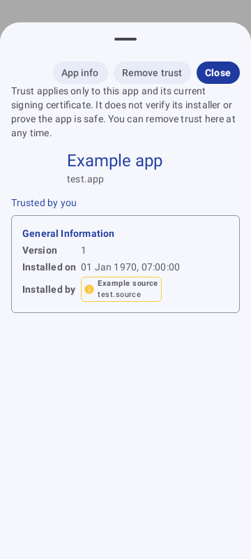

# Changelog

## 1.3.2

- Isolate debug installations with the `.debug` application ID suffix, `-test` version suffix and a distinct Thai/English launcher label so the test APK can coexist with an upstream installation signed by another key.
- Add an offline Thai/English scam-prevention guide in About App with emergency steps, expandable topics, dated official references and a user-initiated AOC 1441 dialer action.
- Cover AI impersonation, malicious links and QR codes, remote support/screen sharing, task jobs, investment-style manipulation, recovery scams and account protection. Explain the prerequisites and variable availability of newer Android protections.
- Clarify that installer recognition, user trust and an empty screen-sharing result cannot guarantee safety; distinguish requested permissions from grants.
- Update privacy disclosures to describe local trust storage, Android backup and external browser/dialer actions.
- Add UI regression checks for guide navigation, expanding/collapsing, source selection and the help action in Thai and English on a 360dp-wide screen.
- See [content sources and maintenance](docs/SCAM_GUIDE_SOURCES.md). This release adds educational content, not automatic scam/deepfake detection.

Validation on Windows/JDK 21, 2026-10-25: debug APK built with versionName 1.3.2/versionCode 30; all 43 unit/UI tests passed; lint passed with warnings. Recorded and visually reviewed the guide in Thai and English at 360dp width. The merged manifest has neither INTERNET nor CALL_PHONE permission. A physical-device check is still required before public APK release.

The isolated test package was revalidated on 2026-10-26: debug build, all 43 tests and lint passed. APK inspection confirmed package `com.akexorcist.ruammij.debug`, version `1.3.2-test`, a separate provider authority, the Thai launcher label and ARM64 support. The user confirmed successful installation of this test APK on a Samsung S24 Ultra on 2026-10-26. Full functional testing on that device has not yet been reported.

[Thai guide preview](image/v1.3.2-safety-guide-th.png) · [English guide preview](image/v1.3.2-safety-guide-en.png)

## 1.3.1

- Fix trusting an app: a user decision now applies to that package and signing certificate, without changing the installer's verification status or trusting other apps from the same installer.
- Add removal of a user trust decision from app details, with English and Thai labels explaining what trust means.
- Refresh trust in the installed-app list and details, and omit personally trusted apps from the overview's unverified-app count. Installer filters continue to describe the installer, independently of user trust.
- Preserve active filters and sorting when a trust decision changes; refresh an open detail sheet with the current app data.
- Upgrade the local database from version 1 to 2 without destructive migration. Old decisions lack signing certificates and require confirmation again.
- Add regression tests for trust isolation, certificate changes, revocation, missing certificates, duplicate decisions, and database migration.

### Validation

See `DEVELOPMENT.md` for reproducible checks. A physical-device check remains required before publishing a release. This patch does not change the existing screen-sharing detection mechanism.

Local validation on Windows with JDK 21, 2026-10-25:

- `:app:assembleDebug`: passed; versionName 1.3.1, versionCode 29.
- `:app:testDebugUnitTest`: 40 tests passed, including 15 new regression tests and repository coverage on API 27 and API 36.
- `:app:lintDebug`: passed, with 22 warnings concerning dependency versions, the launcher vector, and resource shrinking.
- Recorded screenshots and visually reviewed the new trust controls at 360dp width.
- Merged debug manifest has no INTERNET permission.

